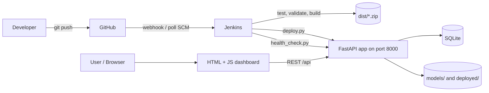
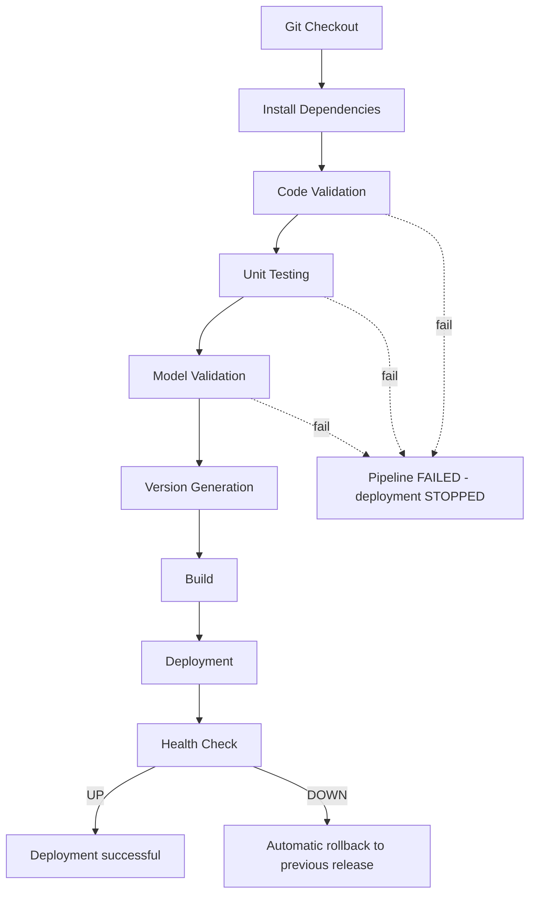
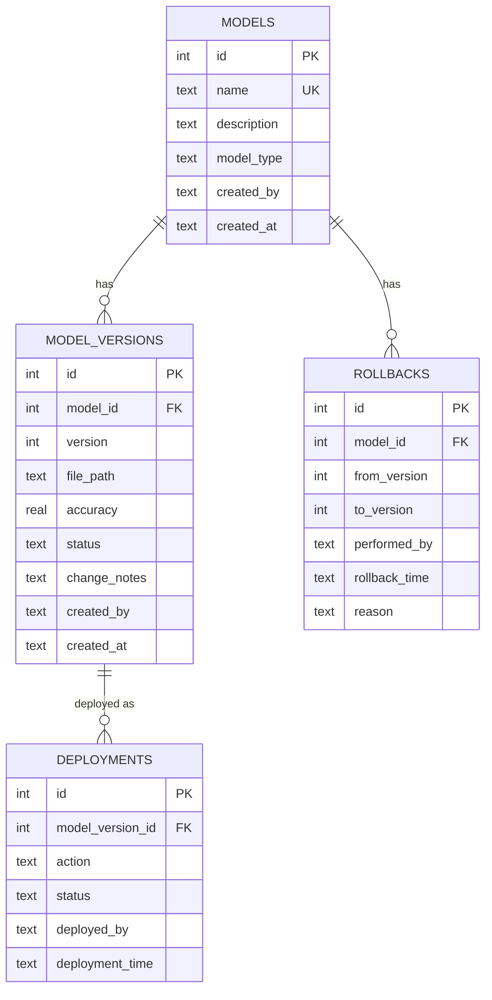

# Model Versioning and Management System (Jenkins CI/CD)

A DevOps mini project: a small web application that stores machine-learning models, keeps
every version with its metadata, promotes a version to **PRODUCTION**, and **rolls back**
to an earlier one, while **Jenkins** automatically tests, validates, builds, deploys and
health-checks the application every time code is pushed.

## 1. Problem Statement
ML models change constantly (new data, new features, retraining). Without version management:
- nobody knows which model is live or who put it there;
- a bad model can reach users with no automatic checks;
- going back to the last good model is slow and manual.

This project solves that with a **model registry** (versions + metadata + status) and a
**CI/CD pipeline** that refuses to deploy anything that fails its tests or validation.

## 2. Objectives
Source control, continuous integration, automated testing, build automation, version
management, deployment automation, release management, and rollback.

## 3. Technology Stack
| Technology | Why it is used |
|---|---|
| Python 3 + FastAPI | REST API; automatic input validation and `/docs` page |
| SQLite (`sqlite3`) | Zero-setup database, a single file |
| HTML / CSS / JavaScript | Simple dashboard, no framework |
| joblib | Loads `.pkl`/`.joblib` model files for validation |
| pytest | Automated unit/API tests |
| pyflakes | Code validation (lint) |
| Git + GitHub | Source control, triggers Jenkins |
| **Jenkins** | **The main DevOps tool: runs the CI/CD pipeline** |

## 4. Why Jenkins?
> Jenkins is used to automate the CI/CD lifecycle of the model management application. It
> automatically builds, tests, validates, and deploys every new version, demonstrating
> continuous integration and continuous delivery.

Docker packages an app; Jenkins *automates the workflow* around it (trigger, test, gate, build, deploy, verify).

## 5. System Architecture


## 6. DevOps Workflow


## 7. Database Schema (ER diagram)

Key rules enforced **in the database**:
- `UNIQUE (model_id, version)` -> no duplicate versions.
- A partial unique index on `status = 'PRODUCTION'` per model -> at most one production version, even if code has a bug.
- `status` is limited by a `CHECK` to `DRAFT, TESTING, STAGING, PRODUCTION, ARCHIVED, FAILED`.

## 8. API Documentation
Interactive docs: `http://localhost:8000/docs`

| Method | Endpoint | Purpose |
|---|---|---|
| GET | `/api/health` | `{"status":"UP","application":"Model Versioning System"}` |
| POST | `/api/models` | Register a model |
| GET | `/api/models` | List models |
| GET | `/api/models/{id}` | Model details (production version, last deployment, rollback target) |
| DELETE | `/api/models/{id}` | Delete (blocked while a version is in production) |
| POST | `/api/models/{id}/versions` | Upload a version (multipart: `file`, `accuracy`, `created_by`, `change_notes`); version number is automatic |
| GET | `/api/models/{id}/versions` | Version history |
| GET | `/api/versions/{id}` | One version |
| PATCH | `/api/versions/{id}/status` | Set DRAFT / TESTING / STAGING / ARCHIVED |
| POST | `/api/versions/{id}/promote` | Validate, then promote to PRODUCTION |
| GET | `/api/models/{id}/deployments` | Deployment + rollback history of a model |
| POST | `/api/models/{id}/rollback` | Roll back (optional `to_version`, `reason`) |
| GET | `/api/models/{id}/rollbacks` | Rollback records |
| GET | `/api/models/{id}/compare?a=1&b=2` | Compare two versions + accuracy improvement |
| GET | `/api/dashboard` | Totals + latest versions |
| GET | `/api/deployments` | Deployment history of all models |

## 9. Upload, Validation and Status Rules
1. Only `.pkl` / `.joblib` accepted; size limit `MVS_MAX_UPLOAD_MB` (default 50).
2. Next version number is generated automatically (`v1, v2, v3 ...`).
3. The file is checked: exists, extension, not empty, size, **loads with `joblib.load`**.
4. Valid -> `TESTING`. Invalid -> saved as `FAILED` and can **never** be promoted.
5. Promote re-validates the file, then: old production -> `ARCHIVED`, new -> `PRODUCTION`,
   file copied to `deployed/<model>/`, a deployment record is written (time + user).
6. If re-validation fails, the new version becomes `FAILED` and **production stays unchanged**.

## 10. Rollback Mechanism
- **Model rollback** (`POST /api/models/{id}/rollback`): the current production version becomes
  `ARCHIVED`; the *previous stable version* (highest lower version that was successfully deployed
  before) becomes `PRODUCTION`; its file is re-published; a `rollbacks` row and a `ROLLBACK`
  deployment row are written. Repeating the rollback keeps going backwards (v3 -> v2 -> v1), never back to the bad version.
- **Application rollback** (`python scripts/deploy.py --rollback`): every release is kept in
  `deploy_target/releases/<version>/`; the previous one is started again. Jenkins runs this
  automatically if the post-deployment health check fails.

## 11. Jenkins Pipeline (`Jenkinsfile`)
| Stage | What it does | Fails when |
|---|---|---|
| Git Checkout | Gets the code from GitHub | repo not reachable |
| Install Dependencies | Creates `.venv`, `pip install -r requirements.txt` | install error |
| Code Validation | `compileall` + `pyflakes` | syntax error / unused import |
| Unit Testing | `pytest` (22 tests), results published in Jenkins | any test fails |
| Model Validation | `scripts/validate_model.py` loads every model file in `models/` | corrupt model |
| Version Generation | Release version `1.0.<BUILD_NUMBER>` | - |
| Build | `scripts/build.py` creates `dist/model-versioning-system-<version>.zip`, archived by Jenkins | build error |
| Deployment | `scripts/deploy.py` unpacks into `releases/<version>` and (re)starts the app | deploy error |
| Health Check | `scripts/health_check.py` polls `/api/health` | no `UP` -> auto-rollback |

A failed stage stops the pipeline, so **a failed build is never deployed**.
The Jenkinsfile uses `sh` on Linux/macOS and `bat` on Windows automatically.

## 12. Installation
Requirements: Python 3.10+, Git (Jenkins only for the CI/CD part).
```bash
git clone <your-repo-url> model-versioning-system
cd model-versioning-system
python -m venv .venv
source .venv/bin/activate          # Windows: .venv\Scripts\activate
pip install -r requirements.txt
```

## 13. Running the Application
```bash
uvicorn backend.main:app --reload          # open http://localhost:8000
pytest -v                                  # run the tests
python scripts/create_sample_models.py     # makes sample_models/ for the demo
```
Optional environment variables (no secrets are stored in code):
`MVS_DB_PATH`, `MVS_MODEL_DIR`, `MVS_DEPLOY_DIR`, `MVS_MAX_UPLOAD_MB`, `MVS_PORT`, `DEPLOY_ROOT`.

## 14. Running Jenkins
1. Install Jenkins (Java 17+), open `http://localhost:8080`, install suggested plugins (Git, Pipeline).
2. The Jenkins machine needs `python3` (with `venv`) and `git`.
3. Push this project to GitHub.
4. **New Item -> Pipeline** -> *Pipeline script from SCM* -> Git -> your repo URL -> script path `Jenkinsfile`.
5. Trigger options:
   - **Poll SCM** (works locally, already in the Jenkinsfile: every 2 minutes), or
   - **Webhook**: tick *GitHub hook trigger for GITScm polling*; in GitHub: Settings -> Webhooks -> `http://<jenkins-host>:8080/github-webhook/` (a local Jenkins needs a tunnel such as ngrok).
6. Push a commit -> the pipeline runs -> app is live on `http://<jenkins-host>:8000`.

## 15. Logging and Security
- Timestamped logs (console + `logs/app.log`): model uploaded, version created, promoted, deployment started/completed, rollback, validation failed.
- Extension whitelist, size limit, API input validation (Pydantic), parameterised SQL (no SQL injection), HTML escaping in the UI, configuration through environment variables.
- Honest limitation: pickle files can run code when loaded. Uploaded files are therefore only loaded in a short-lived separate process with a timeout, never inside the API process, and never executed. A production system would also restrict who may upload.

## 16. Screenshots
_Add your own screenshots here:_ Dashboard | Model upload | Version history | Jenkins pipeline | Deployment history | Rollback

## 17. Demo Script
1. Open the app, set "Acting as" to your name. **Models -> Register** "Student Performance Predictor" (Random Forest).
2. Upload `sample_models/student_v1.pkl` (accuracy 87), then `student_v2.pkl` (accuracy 91) on the model page.
3. **Compare** v1 vs v2 -> shows `+4%`.
4. **Promote** v2 -> PRODUCTION (v1 stays archived).
5. `git push` -> Jenkins runs Checkout -> ... -> Health Check (show the stage view).
6. Faulty version: upload `faulty_model.pkl` -> status FAILED, no Promote button. For CI, commit a corrupt file:
   `mkdir -p models/demo/v3 && echo bad > models/demo/v3/model.pkl`, push -> **Model Validation fails, nothing deployed**.
7. Show production is still v2. Remove the bad file and push again -> green.
8. Promote v1 to production first and v2 afterwards if you want to show **Rollback v2 -> v1** (the button appears on the production row).
9. Open **Deployment history** -> deployments, the rollback and their users/times.

## 18. Viva Questions (beginner-friendly answers)
- **What is CI/CD?** CI: every push is automatically built and tested. CD: if tests pass, it is deployed automatically.
- **What does Jenkins do here?** Runs the `Jenkinsfile` stages on every push and stops at the first failure.
- **What is a Jenkinsfile?** The pipeline written as code and stored in Git.
- **Why not only Docker?** Docker packages the app; Jenkins automates test/build/deploy. Docker can be added later as an enhancement.
- **How is "only one production version" guaranteed?** In code (old production is archived first) and in the database (partial unique index).
- **How does rollback work?** See section 10: statuses swap, the old file is re-published, history is recorded.
- **What if the new deployment is broken?** Health check fails -> Jenkins runs `deploy.py --rollback` -> previous release restarted.
- **Where are versions stored?** Files in `models/<name>/v<N>/`, metadata in SQLite.
- **Why SQLite / no React?** Keeps the project small and runnable anywhere; the focus is DevOps.

## 19. Project Structure
```
backend/   main.py, app/ (config, logger), models/ (schemas), services/, routes/, database/
frontend/  index.html, css/, js/
tests/     test_api.py, test_business_logic.py
scripts/   validate_model.py, build.py, deploy.py, health_check.py, create_sample_models.py
models/    uploaded model files (v1, v2, ...)
Jenkinsfile  requirements.txt  README.md  .gitignore
```

## 20. Optional Enhancement: Docker
After the Jenkins flow works, add a `Dockerfile` and replace the Deployment stage with
`docker build` + `docker run`. Jenkins stays the primary DevOps tool.
